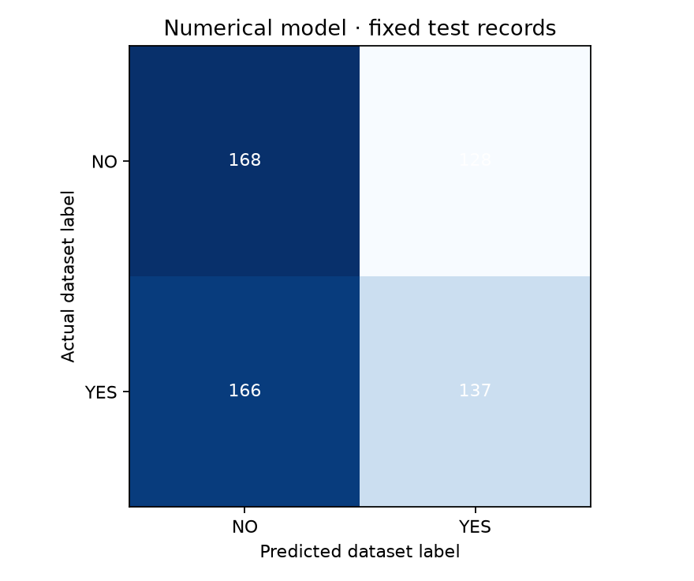
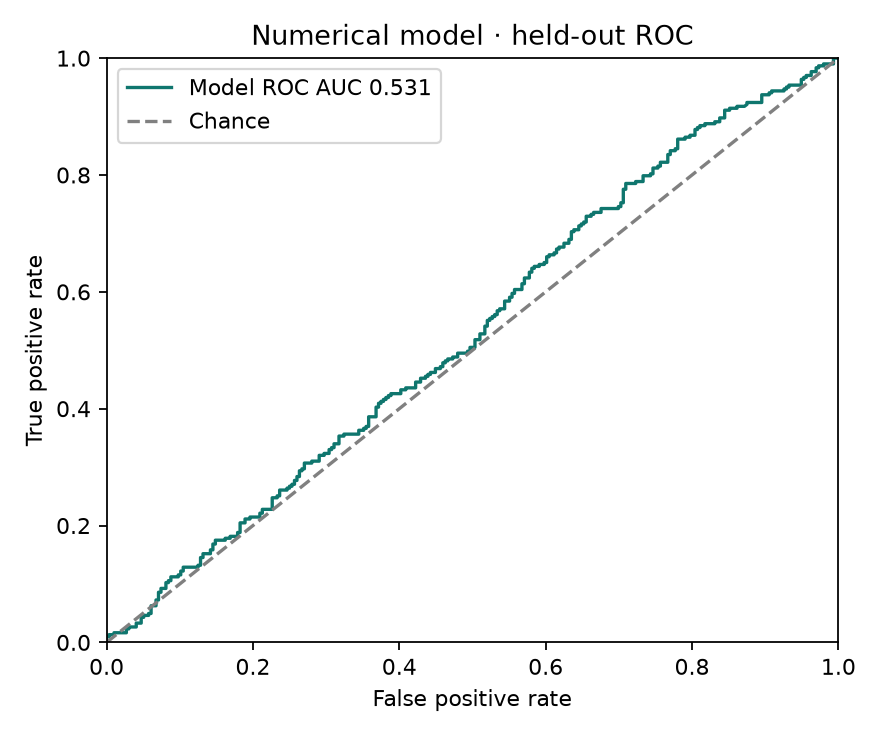

# Lung Cancer Classification Using Numerical Data

## Abstract

This project replaces CT-image identification with a numerical machine-learning workflow using the user-selected Akash Nath Kaggle dataset, version 2. The CSV has 3,000 records, 15 inputs, and binary NO/YES labels. After duplicate removal and ambiguous-profile quarantine, 2,994 records remain. Five candidate tabular classifiers are compared through five-fold training-only cross-validation. Histogram gradient boosting is selected, saved with its preprocessing, and evaluated on 599 reserved records. Test accuracy is 50.92%, compared with 50.58% for the majority-label baseline. The result is near chance; this is an educational numerical ML implementation with no established clinical predictive utility. A local application supports complete record entry, batch CSV prediction, downloads, results, and documentation.

## 1. Scope and source

The task is supervised classification of the source dataset's LUNG_CANCER labels. Inputs are age, a coded gender field, and 13 coded questionnaire features. There is no image feature extraction, cancer-type classification, stage prediction, or defined future-risk horizon. Source: [Akash Nath dataset](https://www.kaggle.com/datasets/akashnath29/lung-cancer-dataset), downloaded version 2. Kaggle license label: Database: Open Database, Contents: © Original Authors. Full provenance and dataset hash are preserved. The publisher description is treated as documentation, not instructions, and the implementation follows the observed CSV rather than references to absent vital signs or treatment data.

## 2. Data audit and preprocessing

Raw labels: 1,482 NO and 1,518 YES. Two duplicate records are removed. Four records from two identical-feature groups containing contradictory labels are quarantined rather than assigning an arbitrary target. Distinct patients could genuinely share these profiles; the dataset supplies no reliable patient identifiers. These decisions leave 2,994 records. Seed 42 stratifies the fixed split: training 1,183 NO + 1,212 YES = 2,395; test 296 NO + 303 YES = 599. Duplicate feature profiles cannot cross partitions.

All inputs become numbers: age in years; GENDER F→0/M→1; other feature codes 1→0/2→1. No missing data or invalid category is silently imputed. Actual column names are normalized, but unexpected fields and target leakage are rejected for prediction. Input ages are restricted to the source range 30–80. StandardScaler is fitted within each cross-validation Pipeline and later on the final training partition only.

## 3. Training and selection

Five predefined candidates use a fixed five-fold stratified training CV. Model selection uses macro F1, with model name as a deterministic tie-breaker. Candidate results:

| Candidate | Mean CV macro F1 | Mean CV ROC AUC |
|---|---:|---:|
| hist_gradient_boosting | 0.5236 | 0.5309 |
| logistic_C0.1 | 0.5129 | 0.5114 |
| logistic_C1 | 0.5125 | 0.5115 |
| random_forest_full | 0.5093 | 0.5194 |
| random_forest_depth6 | 0.5089 | 0.5215 |

The selected estimator is hist_gradient_boosting, with 120 boosting iterations, at most seven leaves per tree, learning rate 0.05, L2 regularization 2, balanced class weighting, and seed 42. It is fitted only to the 2,395 training records. The full initial comparison, fit, and evaluation take 7.02 seconds on CPU. GPU training is unnecessary for this dataset size. Exact estimator parameters and library versions are stored in metadata.

## 4. Held-out evaluation

The selected candidate is frozen before the single reserved-test evaluation. Threshold 0.5 is fixed in advance. Accuracy: 50.92%; balanced accuracy: 50.99%; macro F1: 0.5079; ROC AUC: 0.5309. Accuracy Wilson 95% interval: 46.92%–54.90%. Majority-label baseline accuracy: 50.58%. Results are row-level and do not establish patient independence or clinical performance.

Confusion matrix, rows actual NO/YES and columns predicted NO/YES: [[168, 128], [166, 137]].

The selected model improves accuracy by only 0.33 percentage points over the majority-label baseline. This is not evidence of a reliable clinical classifier. The interface and model card make the weak measured performance explicit. There is no attempt to improve the displayed test score by tuning against the held-out set. Later training runs preserve this test record and report CV only.

## 5. Application and reproducibility

The sidebar groups Overview, Build the model, and Use the model. It includes the requested developer names and Submitted to: Prof. Vaishali Ingale. The dedicated /evaluation route presents metric cards, a highlighted comparison table, grouped charts, confusion matrices, ROC, training-only feature importance, class breakdown, and CV in separate tabs. Candidate CV scores are never labelled as test scores. The sidebar averaging control switches precision/recall/F1 between YES-class and macro averages. Single-record entry requires all 15 values and clears predictions when any field changes. CSV prediction accepts an explicit numerical or source-code encoding, rejects target/extra columns and invalid values, processes uploads in memory, and returns numerical features, dataset label, two model scores, run identity, and artifact hash. Scores are not displayed as individual cancer risk. Model loading verifies the hash, schema, feature order, class order, and scikit-learn version. Preprocessing travels with the model Pipeline. The model is bundled for inference without raw training data.

setup.ps1 installs CPU dependencies. run.ps1 starts the local app. train.ps1 trains a new named run without overwriting old results. The notebook reproduces the numerical workflow and reuses saved training by default. Source, model, data provenance, notebook, reports, tests, and setup scripts are packaged together. Software and portability checks are in numerical/VERIFICATION.json.

## 6. Limitations and future work

Clinical ground truth, individual patient identity, recruitment, and collection procedures are unverified. Source descriptions mention fields absent from the actual CSV, so only observed columns are used. Binary codes are preserved without assuming clinical severity or inventing a codebook. This is a retrospective dataset-label classifier, not a future-risk model, screening recommendation, or diagnosis. Scores are not calibrated individual cancer probabilities. No independent external or patient-level validation is established.

The source dataset is balanced, but this alone says nothing about real-world prevalence or label validity. The near-chance CV and test results warrant investigating data collection and labels, not making stronger accuracy claims. Future work should verify source records, define a clinically meaningful target and prediction horizon, obtain an independently documented cohort, and assess calibration and external performance. Repeated model tuning does not create information missing from the measured features.

## References

1. Akash Nath. [Lung Cancer Dataset, Kaggle version 2](https://www.kaggle.com/datasets/akashnath29/lung-cancer-dataset). Dataset SHA-256 `417052af60ea9da985478d93d6be49749d25c8d0168a14bbd9f94515ab80c6ce`.
2. [scikit-learn Pipeline](https://scikit-learn.org/stable/modules/generated/sklearn.pipeline.Pipeline.html), for preprocessing fitted inside CV.
3. [scikit-learn cross-validation guide](https://scikit-learn.org/stable/modules/cross_validation.html).
4. [scikit-learn model persistence](https://scikit-learn.org/stable/model_persistence.html), including trusted-artifact and version constraints.
